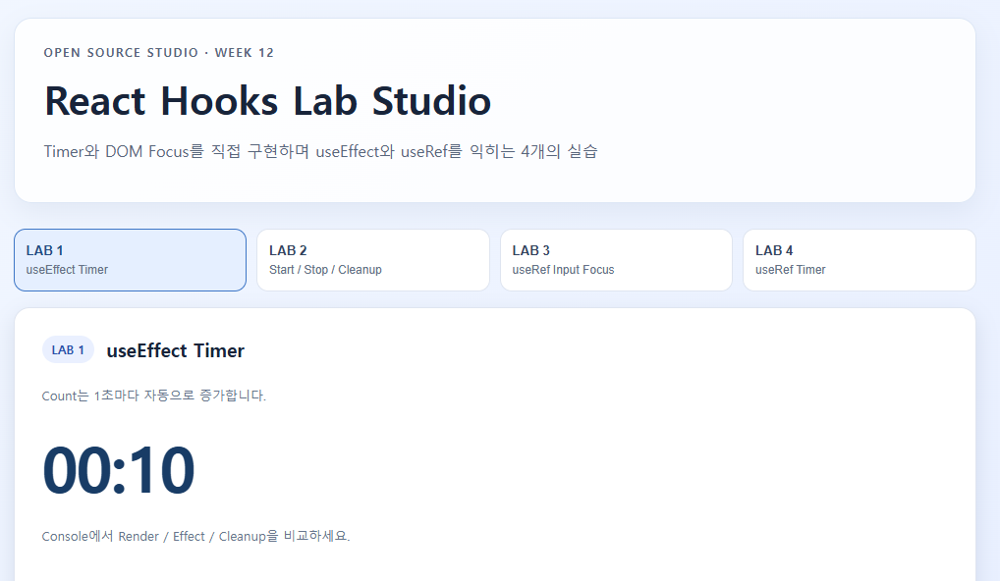
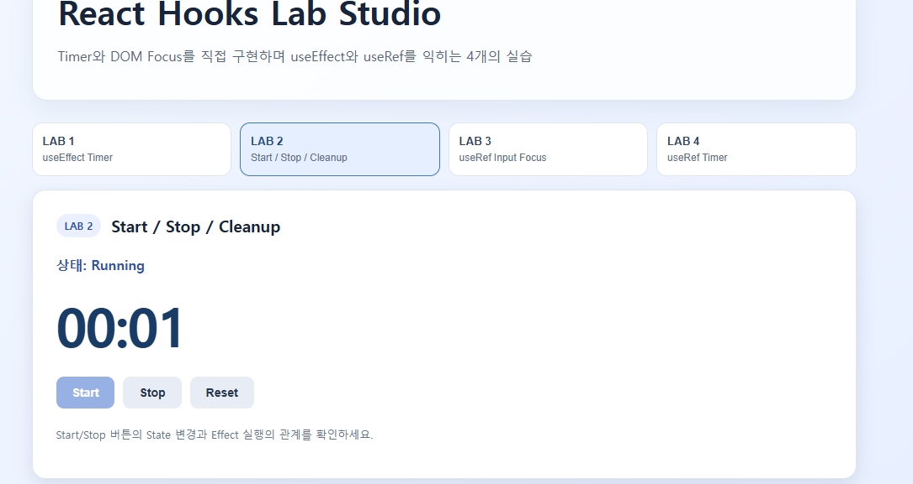
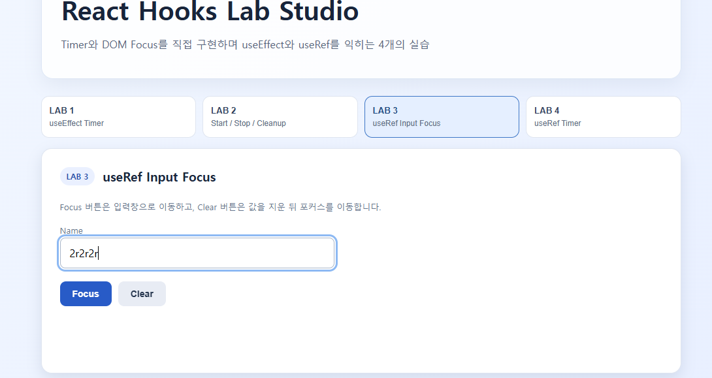
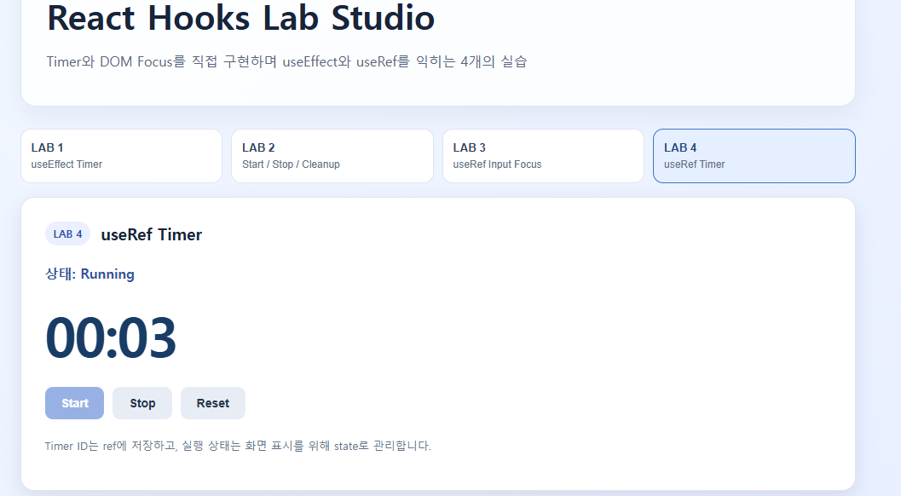

##### 1 프로젝트 소개

React Hooks Starter Project를 바탕으로 useEffect와 useRef를 연습하는 12주차 실습이다

시작 자료: https://github.com/2026-2-OSS/week12_starter_project

##### 2 설치와 실행

npm.cmd install

npm.cmd run dev

##### 3 소스 코드 살펴보기

App.jsx는 탭을, components는 실습 코드를, App.css는 화면 스타일

주요 코드 1: 실습 1은 useEffect와 setInterval로 수를 올리고 함수형 업데이트로 최신 값을 사용하며 정리 함수로 타이머를 멈춘다

주요 코드 2: 실습 3은 useRef.current로 입력창에 접근해 포커스를 주고 값을 지운다

##### 4 실습 구현

실습 1은 1초 타이머와 언마운트 정리, 실습 2는 running 상태에 따른 시작·정지·초기화, 실습 3은 입력 포커스와 지우기, 실습 4는 타이머 ID 저장과 중복 방지·정리를 구현했다

##### 5 실습 비교

의존성 배열은 Effect를 다시 실행할 조건을 정한다

정리 함수가 없으면 타이머가 계속 실행되거나 중복될 수 있다

useState는 값이 바뀌면 화면을 다시 그리고 useRef.current는 바뀌어도 화면을 다시 그리지 않는다

실습 2는 running 상태에 따라 Effect가 타이머를 관리하고 실습 4는 참조값에 저장한 타이머 ID를 버튼에서 직접 관리한다

##### 6 꾸미기

제목과 색상을 바꿧다.

수정 파일: App.jsx, App.css, index.html, Lab1_EffectTimer.jsx, Lab2_TimerControl.jsx, Lab3_InputFocus.jsx, Lab4_RefTimer.jsx, formatTimerTime.js

##### 7 배포

##### 8 주간 정리

새로 배운 점: 의존성 배열, 정리 시점, useState와 useRef의 차이

어려웠던 점: 타이머 중복 방지 원리와 이유를 처음에는 이해하기 어려웠지만 AI 설명으로 정리했다

AI 활용: PDF 요약, 코드 검토, 오류 원인 확인, 과제 내용 정리에 사용했고 직접 실행 확인도 필요하다고 느꼈다
